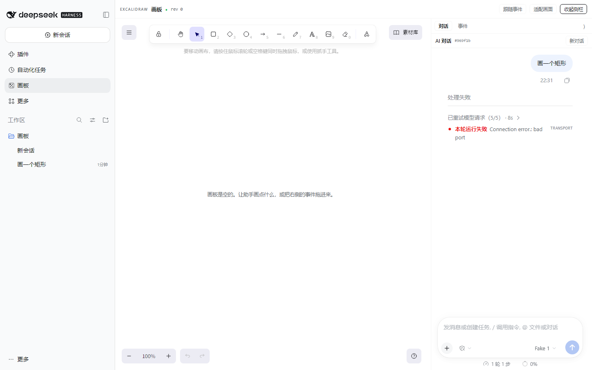
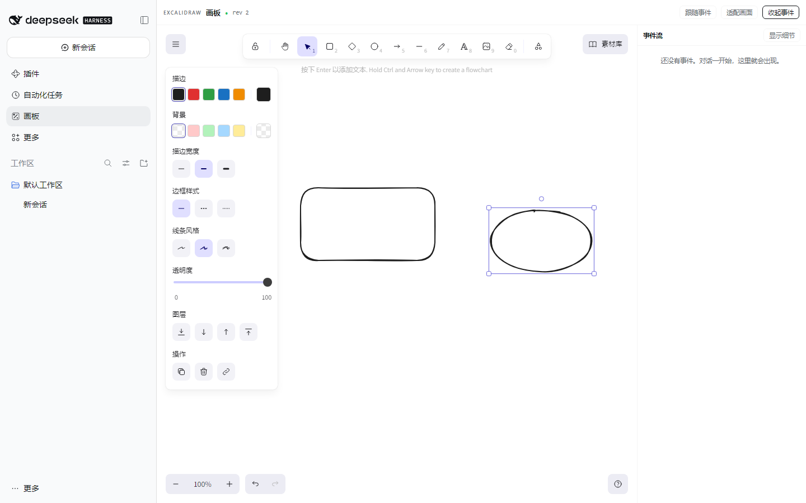

# dsh-excalidraw

[](https://github.com/tu10ng/dsh-excalidraw/actions/workflows/verify.yml)

A persistent Excalidraw board beside the conversation, in the left sidebar next
to **工作树** and **终端** — with its own AI column.





Two things make it more than an embedded canvas:

1. **It has its own AI column, exactly like 工作树.** The panel's right side embeds
   a real DSH conversation — the Host's own transcript, composer, streaming, and
   tool cards — in a session this plugin created and pinned to the sidebar. That
   conversation is told, through a system-prompt section, what the board is and
   how to change it, so "画一个三步流程" lands on the canvas while you watch.
   A second tab of the same column is the session event rail.
2. **Every session event can reach the board.** One SSE stream carries both board
   changes and normalized `session/event` rows. Any row can be dropped on the
   canvas, where it becomes an element bound to that exact event; the agent can
   bind elements itself with a tool.
3. **The agent edits without stealing your hand.** Before an agent transaction
   touches an element, the element is locked in the file and shown as another
   collaborator's selection. An element you are dragging or editing is never
   replaced mid-gesture: the change is postponed until you let go. Every write
   carries a revision, so a stale one re-reads instead of overwriting.

Data lives outside every project, one board per directory:

```
$DSH_HOME/excalidraw/<board>/
  board.excalidraw      # a plain Excalidraw scene, openable on excalidraw.com
  board.dsh.json        # revision, leases, journal — never the scene
```

## Install

```bash
git clone https://github.com/tu10ng/dsh-excalidraw.git
dsh plugin --profile web add "$(pwd)/dsh-excalidraw"
```

or, inside a conversation, `plugin_manager` with `action: install_bundle` and
this package's absolute directory. On a fresh profile the panel appears after
the next `dsh web` boot. When the manager reports `restart-required`, that is
the profile's package resolution changing under a running Host — restart
`dsh web` once; the board survives.

Verified against DSH `0.2.2-rc.1` on Windows.

## Config

The bundle row is `excalidraw`; override its `config` in the profile's
`cordis.patch.yml`:

```yaml
- id: excalidraw
  config:
    root: ''        # empty = $DSH_HOME/excalidraw
    board: main
    waitMs: 1500    # how long a tool waits for the panel to acknowledge
    leaseMs: 20000  # a lease outlives this, then the board unlocks itself
    maxEvents: 400  # rows the event rail keeps live
    chatCwd: ''     # working directory of the board's conversation; empty = home
    guidance: true  # explain the board to its conversation
```

## Agent tools

| Tool | What it does |
|---|---|
| `excalidraw_read` | Element summaries (id, type, position, text, lock, binding) or full JSON |
| `excalidraw_apply` | `create` / `patch` / `delete` / `lock` / `unlock` ops, applied as one transaction |
| `excalidraw_bind` | Bind elements to a session event (default: the latest one in this session) |
| `excalidraw_status` | Revision, held elements, transaction progress |
| `excalidraw_release` | Hand elements back early |

`excalidraw_apply` returns `committed` (the panel acknowledged), `headless` (no
panel open, nobody to lock against, written directly), or `pending` (written,
the panel did not answer within `waitMs`). Elements the person is holding are
reported as `deferred`: the panel applies them as soon as the gesture ends.

## The lock, in one paragraph

A transaction takes a lease on every id it names. The Host writes the optimistic
elements with `locked: true` and `customData.dsh.lock`, so a person cannot pick
them up, and pushes the ops over SSE. The panel applies them with Excalidraw's
own layout engine, paints the leased elements as a collaborator's selection
(Excalidraw renders that natively), and commits the scene it actually holds back
with the revision it was based on. The Host replaces the scene, unlocks, writes,
and answers the tool. Anything the person was holding is skipped, restored, and
re-applied after `onPointerUp`. A lease that outlives `leaseMs` (closed tab,
crashed browser) is unlocked by the sweep timer, and locks left by a dead
process are repaired on load.

## Layout

```
lib/
  index.js              Host half: composition
  scene-store.js        the board: file, revision, leases, transactions
  elements.js           element model, locks, op application
  ops.js                strict validation of the model's ops
  chat.js               the board's own conversation (created, remembered, reset)
  prompt.js             what that conversation is told about the board
  session-events.js     SessionEvent → one rail row
  event-journal.js      cursor-addressed live window
  routes.js             HTTP: state / save / tx / cancel / chat / stream / assets
  assets.js             static assets, path-jailed
  atomic.js             atomic file replacement
  tools.js              the five agent tools
  client.js             classic-script loader: sidebar cell + main panel + chat slot
  client/
    panel.js            header, canvas, AI column, inspector
    canvas.js           Excalidraw + merge engine
    chat.js             native conversation embed (SessionProvider + renderSlot)
    board-ops.js        browser-side op application
    rail.js             the event rail
    api.js              HTTP client
    i18n.js             zh / en copy
    vendor-loader.js    loads the vendored Excalidraw once
    panel.css           chrome, theme tokens only
  shared/protocol.js    the wire contract (no imports; served to the browser)
  vendor/               Excalidraw 0.18.1 bundle, CSS, fonts (generated)
```

## Development

```bash
npm run check     # static rules: classic client, no Node in the browser half, token names…
npm test          # element model, ops, store, journal, event normalization, assets
npm run verify    # both
npm run build:vendor  # regenerate lib/vendor from a pinned npm install (network)
```

The vendor bundle is committed, so installation needs no network. `react`,
`react-dom`, and `react/jsx-runtime` stay external and come from the Host page's
module table — one React in the page, never two. Mermaid is stubbed out; the
text-to-diagram dialog is not part of this board and Mermaid alone doubles the
bundle.

## Known limits

- One board per plugin instance; `board` picks it. Multiple boards need a board
  switcher, not more code in the store.
- The board conversation is an ordinary session, so it also appears under the
  workspace that matches `chatCwd` (a `画板` workspace is created when none
  matches). Deleting it there just means the panel creates the next one on open.
- Agent edits do not enter your undo stack (`CaptureUpdateAction.NEVER`), which
  is the collaboration contract; ask the agent to revert instead.
- Text layout is measured by the browser. In a headless run the Host writes an
  estimate, and the first browser that opens the board replaces it with real
  metrics.
- The panel keeps the last 400 events; older ones are gone from the rail, not
  from the session log.
